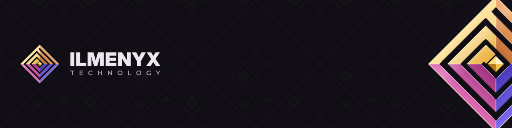

  <a href="https://ilmenyx-technology.github.io"><b>Site</b></a> ·
  <a href="https://ilmenyx-technology.github.io/sobre/">Sobre</a> ·
  <a href="https://ilmenyx-technology.github.io/novidades/">Novidades</a> ·
  <a href="mailto:ilmenyx.technology@gmail.com">Contato</a> ·
  <a href="#english">English</a>

## Estrutura para criar. Liberdade para explorar.

A **Ilmenyx Technology** é um estúdio independente de tecnologia, nascido no Brasil. Criamos software, serviços digitais e
jogos, com um pé no open source e outro em projetos que se sustentam por conta própria. Gostamos de coisas bem construídas,
fáceis de entender e que dá vontade de explorar.

### O que fazemos

- **Software e ferramentas.** Apps que resolvem problemas reais do dia a dia, começando pelo Linux: entender o próprio PC,
  manter tudo funcionando e jogar sem dor de cabeça.
- **Serviços digitais e automações.** Soluções sob medida para tirar trabalho repetitivo do caminho.
- **Jogos.** Desenvolvimento de jogos, a parte do estúdio que mais queremos ver crescer.

### Projetos

| Projeto | Do que se trata | Estado |
|---|---|---|
| [**Ilmenyx Controller**](https://github.com/Ilmenyx-Technology/ilmenyx-controller) | Diagnóstico, monitoramento e benchmark de hardware para Linux, com ferramentas para jogos. PT · EN · ES. | Pré-lançamento · [baixar](https://github.com/Ilmenyx-Technology/ilmenyx-controller/releases/latest) |

Outros projetos estão em andamento e aparecem aqui quando estiverem prontos para o mundo.

### Como trabalhamos

- **Aberto quando dá.** Código público sempre que possível, e o essencial sem custo.
- **Claro antes de esperto.** Explicamos o que está acontecendo, em linguagem simples, para quem está começando.
- **Nada muda sem você.** Qualquer alteração mostra antes o que vai fazer e tem como ser desfeita.
- **Medido, não chutado.** Testamos em hardware real e não inventamos números.
- **Sustentável e honesto.** Serviços e extras opcionais mantêm os projetos vivos, sem prender ninguém.

### Participe

Encontrou um problema ou tem uma ideia? Abra uma issue no projeto. Quer testar em outro PC, distro ou placa de vídeo? É uma
das formas que mais ajudam. Para apoiar financeiramente: [Ko-fi](https://ko-fi.com/ilmenyxtechnology) ou
[Pix](https://ilmenyx-technology.github.io/apoie/).

**Contato:** [ilmenyx.technology@gmail.com](mailto:ilmenyx.technology@gmail.com) · falhas de segurança por e-mail, nunca em issue pública.

---

## English

**Ilmenyx Technology** is an independent technology studio from Brazil. We build software, digital services and games, with
one foot in open source and the other in projects that sustain themselves. We like things that are well built, easy to
understand and worth exploring.

**What we do:** software and tools that solve everyday problems (starting with Linux), custom digital services and
automations, and game development.

**Projects:** [**Ilmenyx Controller**](https://github.com/Ilmenyx-Technology/ilmenyx-controller), hardware diagnostics,
monitoring and benchmarking for Linux, with gaming tools, in English, Portuguese and Spanish (pre-release,
[download](https://github.com/Ilmenyx-Technology/ilmenyx-controller/releases/latest)). More projects are in the works.

**How we work:** open whenever possible, clear before clever, nothing changes without you, measured instead of guessed, and
sustainable without locking anyone in.

**Get in touch:** [ilmenyx.technology@gmail.com](mailto:ilmenyx.technology@gmail.com) ·
[website](https://ilmenyx-technology.github.io/en/) · [Ko-fi](https://ko-fi.com/ilmenyxtechnology)
